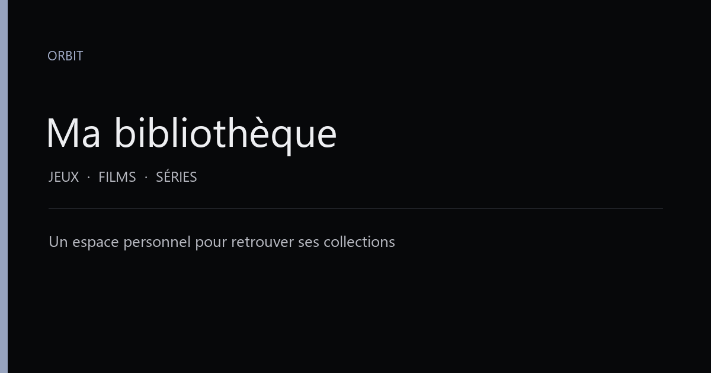

# Orbit

**Orbit réunit tes jeux, tes films et tes séries dans un carnet personnel sur Windows.** Retrouve le jeu que tu as lancé hier, les heures que tu y as passées et la série que tu veux reprendre ce soir.



## Installer Orbit

1. Ouvre la [page des versions](https://github.com/noeloddo0-cpu/orbit-page/releases) et télécharge le fichier `Orbit-Setup-…exe` de la version souhaitée.
2. Lance l’installateur sur Windows 64 bits, puis ouvre **Orbit** depuis le menu Démarrer.
3. Au premier lancement, l’application de bureau ouvre **Connecter Discord**. Choisis ton fichier `.env` ou renseigne ton bot. Pour essayer le carnet dans un navigateur sans Discord, suis les instructions de développement ci-dessous.

Une nouvelle bibliothèque commence vide. Dans **Orbit Play → Importer Steam**, tu peux récupérer les jeux installés sur ton PC. Dans **Bibliothèque → Ajouter**, tu peux aussi saisir les titres toi-même.

## Dans l’application

| Espace              | Ce que tu peux y faire                                                                                                                                                        |
| ------------------- | ----------------------------------------------------------------------------------------------------------------------------------------------------------------------------- |
| **Bibliothèque**    | Classer tes jeux par statut, suivre les heures et consulter, modifier ou supprimer toutes tes sessions.                                                                       |
| **Orbit Play**      | Parcourir les jaquettes verticales, lancer les jeux Steam installés, créer des collections et noter les plateformes que tu possèdes. Les applications ont leur propre onglet. |
| **Films et séries** | Tenir une liste à voir, noter tes visionnages, suivre une saison ou un épisode et retrouver un film par date dans le journal.                                                 |
| **Réglages**        | Choisir l’apparence, exporter tes données, restaurer une sauvegarde ou vérifier les mises à jour.                                                                             |

## Relier tes services

**Discord.** Le suivi utilise l’activité « En jeu » affichée par Discord. Le bot doit partager un serveur avec le compte suivi et avoir **Presence Intent** activé. L’ordinateur doit rester allumé avec Orbit en cours d’exécution pour enregistrer une session. Pour créer ta configuration locale, copie `.env.example` sous le nom `.env` puis remplis les champs sur ton PC.

**Steam.** L’import lit les bibliothèques Steam installées sur cet ordinateur. Les boutons **Importer Steam** et **Jaquettes verticales** permettent de récupérer les jeux et leurs couvertures. Si plusieurs titres se ressemblent, ouvre **Ma fiche** pour choisir l’image ou en importer une.

**TMDB.** Dans **Réglages → Affiches de films**, ajoute ton jeton de lecture TMDB pour chercher les fiches et les affiches. Cette application utilise l’API TMDB, sans approbation ni certification de TMDB.

## Lancer depuis le code

Avec Node.js 24 LTS et npm, dans le dossier du projet sur Windows :

```powershell
npm ci
npm run check
npm run app
```

Pour essayer la version navigateur, lance `npm start` après `npm ci`, puis ouvre [Orbit sur cet ordinateur](http://127.0.0.1:3181/). Le lancement natif des jeux et les actions de sauvegarde Electron sont disponibles dans l’application de bureau.

La copie de référence est **`Orbit-GitHub`**. La copie `discord-bridge` est conservée comme archive de lecture seule : ne la modifie plus à la main. Les builds de release partent d’un clone propre de ce dépôt.

## Données et sauvegardes

L’application de bureau conserve tes données dans `%APPDATA%\orbit`. La fermeture de la fenêtre réduit Orbit dans la zone de notification. Pour l’arrêter complètement, fais un clic droit sur son icône puis choisis **Quitter Orbit**.

Pour transférer ta collection, utilise **Réglages → Données et sauvegardes → Exporter** sur le premier PC, puis **Importer** sur le second. Garde l’export dans un emplacement privé. La version navigateur lancée avec `npm start` écrit ses données dans le dossier du projet par défaut.

Depuis la version 1.0.32, chaque sauvegarde contient un manifeste et des empreintes SHA-256. Le bouton **Tester la dernière** relit les fichiers sans rien restaurer. Les fichiers abîmés sont conservés en `.corrupt-<horodatage>` avant toute réparation automatique. Le panneau **Santé et diagnostic** donne les compteurs et les anomalies sans modifier les données.

Le pont local n’accepte les modifications qu’avec le jeton aléatoire injecté dans la page ; une page externe ne peut pas piloter Orbit. Les secrets saisis dans l’application sont chiffrés par Windows. Si tu lances `npm start` en dehors d’Electron, utilise un `.env` de développement : le coffre `safeStorage` n’est disponible que dans l’application de bureau.

## Construire une version Windows

```powershell
npm ci
npm run check
npm run dist:installer
```

L’installateur est créé dans `dist/`. Le dépôt comprend aussi une action GitHub pour le construire sur Windows et préparer une version en brouillon. La procédure complète, le contenu attendu et le retour arrière sont décrits dans le [guide de publication](docs/RELEASE.md). Les changements visibles sont dans le [changelog](CHANGELOG.md).

## Projet et crédits

Projet personnel de **noeloddo0-cpu**, destiné à regrouper progressivement d’autres activités. Les attributions des thèmes, des polices et des services sont détaillées dans les [crédits](THIRD_PARTY.md). Les licences des composants tiers restent applicables. Aucune licence libre n’a été choisie pour le code propre à Orbit.

[Signaler un problème](https://github.com/noeloddo0-cpu/orbit-page/issues)
